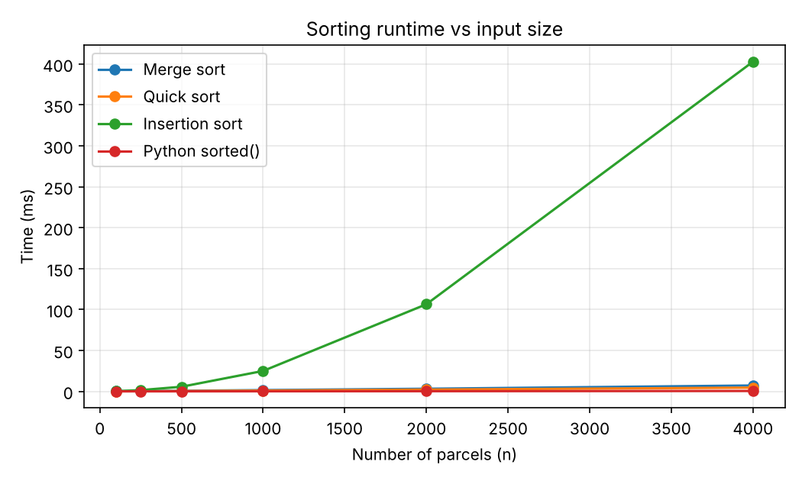
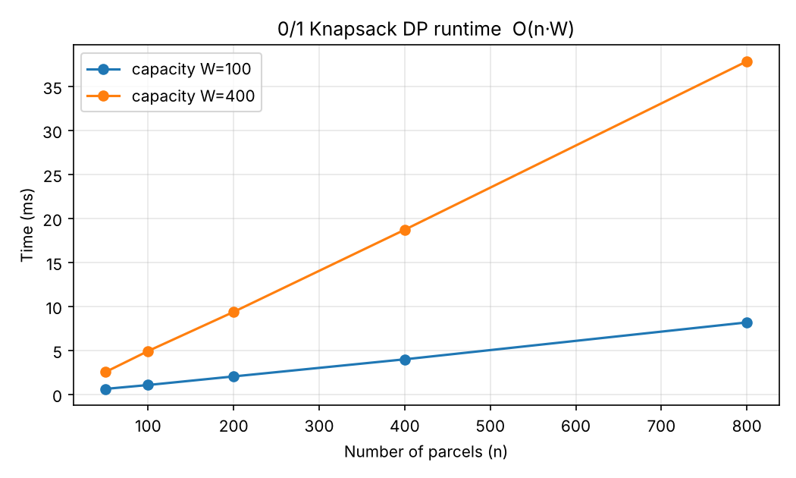
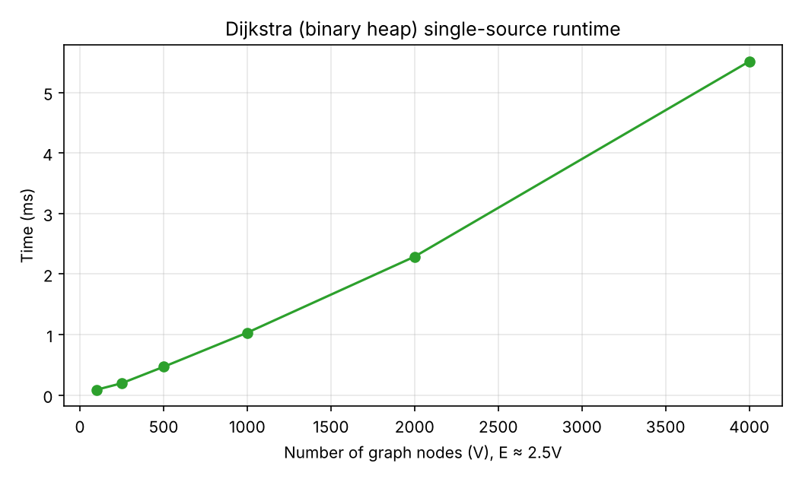
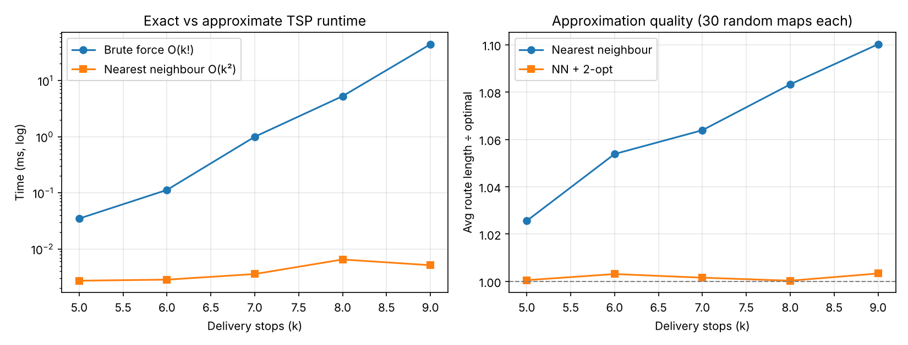
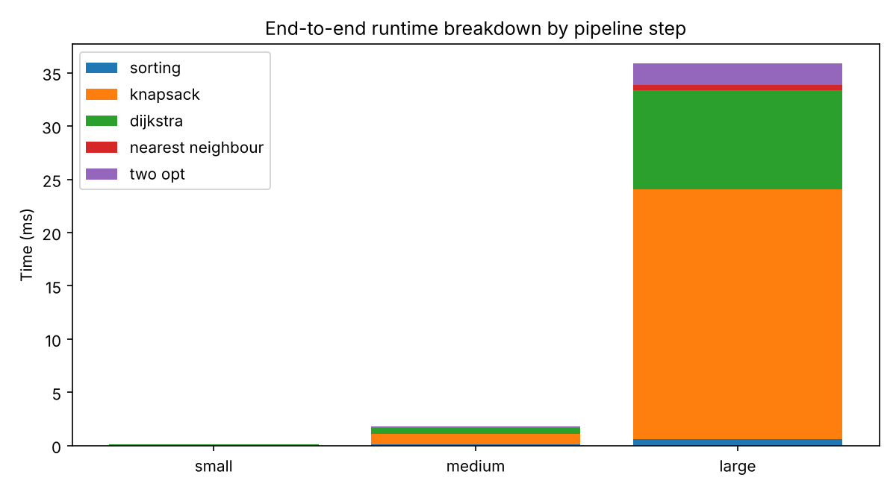

# Phase 1 — Problem Design and Planning

**Problem.** A courier van leaves a depot (node 0) with limited capacity. Many parcels are waiting, each for some address on a road network. We must decide (a) in what order to consider parcels, (b) which parcels fit in this trip so the most important ones go, and (c) in what order to visit the delivery points so the distance driven is small.

**Data design.**

| Entity | Fields |
|---|---|
| Parcel | `parcel_id`, `dest` (graph node), `weight` (kg), `priority` (1–10), `deadline_hr` |
| Road graph | undirected weighted graph; adjacency list `{u: [(v, km), ...]}`; node 0 = depot |
| Van | capacity in kg |

**Parcel value** used by the knapsack: `priority × 10 + 20 if deadline ≤ 4 h`, so urgent parcels get a boost.

**Pipeline and algorithm choice**

| Step | Algorithm | Why this one | Time / Space |
|---|---|---|---|
| Prioritise parcels | Merge sort, key = (deadline, −priority) | Guaranteed O(n log n); **stable**, so equal parcels keep arrival order | O(n log n) / O(n) |
| Choose trip load | 0/1 Knapsack, bottom-up DP | A parcel is either loaded or not; greedy can miss the optimum | O(n·W) / O(n·W) |
| Shortest paths | Dijkstra with binary heap | All road lengths are positive | O((V+E) log V) per source |
| Visit order | Nearest-neighbour TSP + 2-opt | Exact TSP is O(k!) — impractical beyond ~10 stops | O(k²) / O(k²) |

**How they work together:** sorted list → knapsack picks the loaded parcels → their destinations become the stop set → Dijkstra from the depot and each stop builds a stop-to-stop distance matrix → NN-TSP orders the stops → 2-opt shortens the tour → hops are expanded into real road paths using Dijkstra's parent pointers.

# Phase 2 — Package Prioritisation and Box Filling

Implemented in `algorithms.py` (`merge_sort`, `knapsack_dp`). Evidence — small dataset (12 parcels, capacity 30 kg), see `screenshots/output_small_dataset.png`:

* Sorted order starts P0007 (deadline 2 h, priority 10), P0008 (2 h, prio 4), P0005 (3 h), P0006 (4 h, prio 10), …
* Knapsack loads **9 of 12 parcels, 28 kg, total value 730**; deferred: P0003, P0010, P0012 (low value for their weight).
* The DP table `dp[i][c]` = best value using the first *i* parcels with capacity *c*; the chosen set is recovered by backtracking (`dp[i][c] != dp[i-1][c]` ⇒ parcel *i* was taken).

**Why DP and not greedy?** On 200 random instances, greedy-by-value/weight was sub-optimal in 92 cases (average 98.8 % of the DP value, worst 88.6 %). DP always matched brute force in the unit tests.

# Phase 3 — Route Maker and Graph Processing

* Graph built from `graph.csv` as an undirected adjacency list.
* Dijkstra gives exact depot→stop distances (e.g. stops 1, 3, 4, 6, 7 are 6, 10, 11, 3, 4 km away). Unreachable nodes correctly return ∞.
* Distances between stops form a complete matrix; **nearest-neighbour** route for the small dataset: `0→6→7→1→3→4→0` = **43 km**; after **2-opt**: `0→6→4→3→1→7→0` = **37 km**.
* Final road path (expanded through intermediate junctions): `0→6→4→5→3→1→0→7→0`.

| Dataset | Parcels | Loaded | Stops | NN route (km) | After 2-opt (km) |
|---|---|---|---|---|---|
| small (cap 30) | 12 | 9 | 5 | 43 | 37 |
| medium (cap 150) | 60 | 31 | 21 | 215 | 197 |
| large (cap 600) | 300 | 135 | 86 | 1051 | 947 |

# Phase 4 — Performance Testing and Optimisation

**Correctness tests** (`tests/test_algorithms.py`, 11 tests, all pass — `screenshots/unit_tests.png`): all three sorts equal `sorted()` incl. empty, single, sorted, reversed inputs; merge sort stability; knapsack = brute force on 50 random cases + edge cases (item too heavy, empty list); Dijkstra = Bellman-Ford on a 25-node random graph; tours are valid cycles and 2-opt ≤ NN; full pipeline on all three datasets.

**Runtime experiments** (best of 3 runs, times in ms, machine-dependent):

{width=75%}

| n | 100 | 500 | 1000 | 2000 | 4000 |
|---|---|---|---|---|---|
| Merge sort | 0.11 | 0.65 | 1.54 | 3.17 | 7.16 |
| Quick sort | 0.06 | 0.41 | 0.95 | 2.14 | 4.52 |
| Insertion sort | 0.23 | 5.62 | 24.95 | 106.45 | 402.86 |

Doubling *n* roughly quadruples insertion sort (O(n²)) but only slightly more than doubles merge/quick sort (O(n log n)). Quick sort is faster in practice but is not stable and has an O(n²) worst case, so merge sort is used in the planner. (Python's built-in `sorted()` is far faster because it is written in C; it is shown only as a reference.)

{width=75%}

Knapsack time grows linearly in *n* and linearly in capacity *W* (W=400 is ≈4.6× slower than W=100), matching O(n·W).

{width=75%}

Dijkstra scales close to linearly (4000 nodes ≈ 5.5 ms), consistent with O((V+E) log V).

{width=95%}

Brute force explodes factorially (9 stops ≈ 45 ms, and each extra stop multiplies it); nearest neighbour stays in microseconds. On random Euclidean maps with 5–9 stops, NN was on average 2.6 %–10 % longer than optimal, and **NN + 2-opt was within 0.6 % of optimal**. (This quality test uses random point maps so that the exact optimum can be computed; on the road graphs the optimum is not known.)

{width=75%}

End-to-end on the large dataset (300 parcels, 86 stops): knapsack 23.5 ms and Dijkstra 9.3 ms dominate; sorting 0.6 ms, NN 0.4 ms, 2-opt 2.1 ms.

**Optimisation suggestions**

1. *Knapsack:* it is the bottleneck. Use a 1-D DP array (O(W) memory) when the table is not needed, or scale weights to coarser units to shrink W.
2. *Dijkstra:* we run it once per stop; stop early once all stops are settled, or run it only from stops actually selected (already done).
3. *Route:* Or-opt / Christofides (1.5-approximation for metric TSP) or time-window constraints for the deadlines — currently deadlines influence only load selection, not visiting order.
4. *Multiple trips:* repeat knapsack on the deferred parcels for trip 2, 3, … until none remain.

# Phase 5 — Result Explanation and Demonstration

Screenshots in `screenshots/`: `output_small_dataset.png`, `output_medium_dataset.png`, `unit_tests.png`. Run steps are in `README.md`.

**Reading the output.** The report lists the sorted parcels, the knapsack result (which parcels travel, which are deferred), the stops, depot→stop Dijkstra distances, both routes with lengths, and per-step timings.

**Limitations (honest notes).** Nearest-neighbour and 2-opt are heuristics: no optimality guarantee. The datasets are synthetic and seeded. Deadlines are used for ordering/value, not as hard time-windows. Timings are from one machine and vary between runs.

**Viva quick reference**

* *Why merge sort?* Stable, always O(n log n). *Why not insertion?* O(n²).
* *Knapsack recurrence:* `dp[i][c] = max(dp[i-1][c], dp[i-1][c-w_i] + v_i)` if `w_i ≤ c`, else `dp[i-1][c]`.
* *Why Dijkstra can't handle negative edges:* it assumes a settled node's distance is final.
* *NN-TSP complexity:* k stops × scan of ≤k candidates = O(k²).
